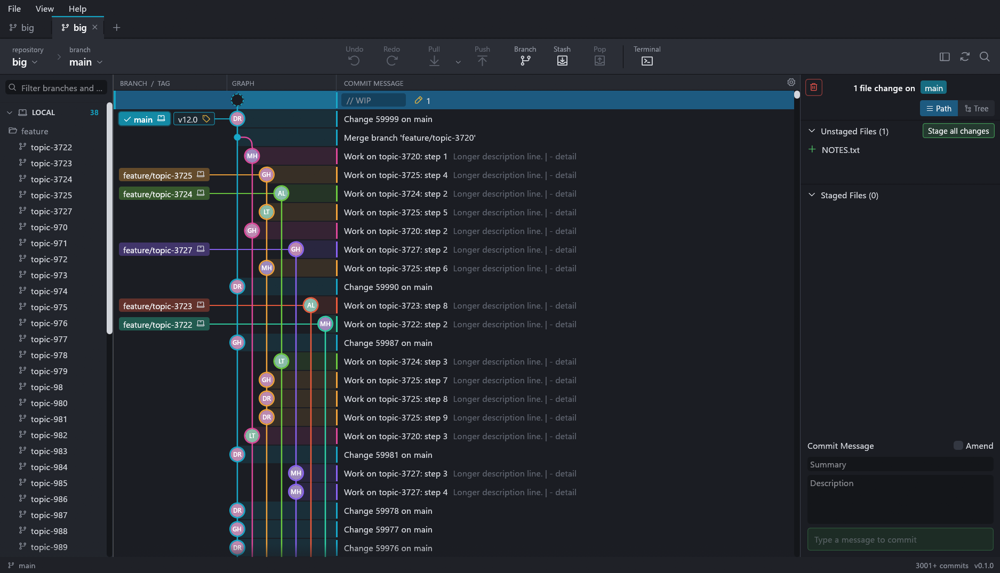
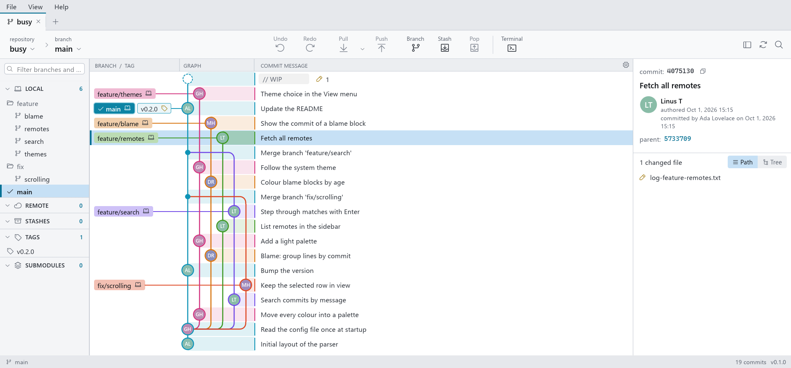
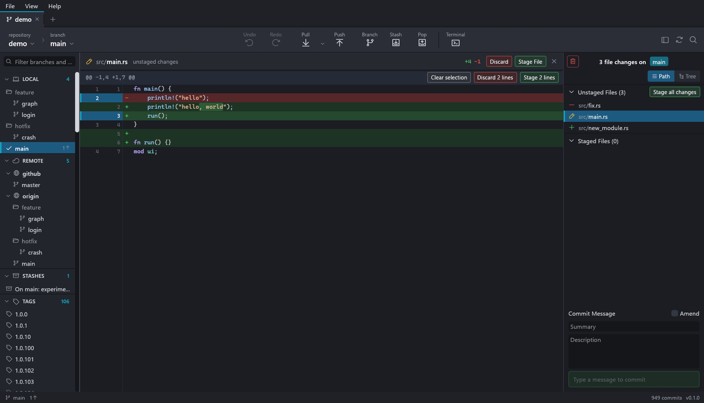
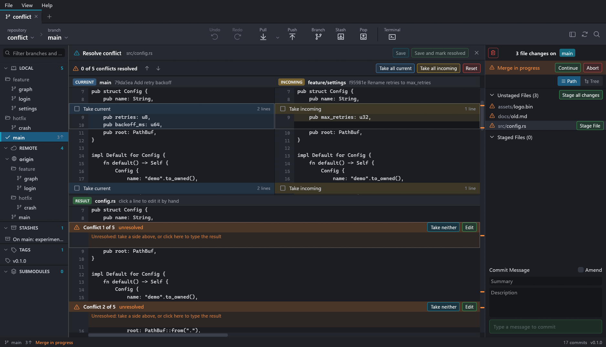
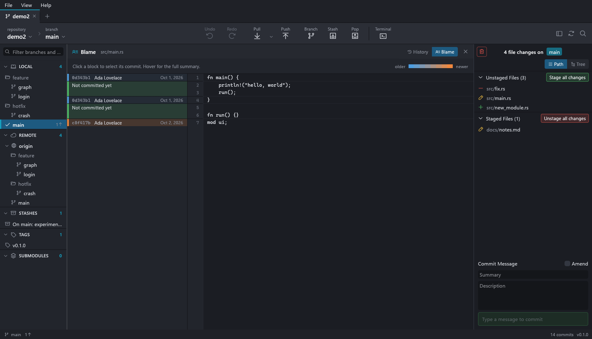

# GitKrill

[](https://github.com/moulmandev/GitKrill/actions/workflows/build.yml)

A fast, native Git client with a commit graph, written in Rust. Small and
quick, like its namesake: it idles at zero CPU, uses about 100 MB of memory and
shows the first page of a 60,000-commit history in a few tens of milliseconds.

Each repository opens in its own tab, with a ref sidebar, the graph in the
middle, and a staging / commit-details panel on the right.











## Install

From the [latest release](https://github.com/moulmandev/GitKrill/releases/latest).

GitKrill needs Git to change repositories (it reads them without it). When
Git is missing:

- the Windows installer offers, ticked, to download Git for Windows and
  install it for your account only (no administrator rights; about 65 MB,
  checked against the SHA-256 GitHub publishes for it). Unattended installs
  do that only with `/INSTALLGIT=1`;
- GitKrill itself, any download, says so when it starts and keeps a
  **Git not found** warning in the status bar. On Windows it installs Git
  for Windows the same way in one click; on macOS it starts Apple's Command
  Line Tools install (or use `brew install git`); on Linux it shows the
  command for your distribution.

Git is found on `PATH` or where its installers put it, so a Git installed
while GitKrill runs, or one left off `PATH`, works too.
`gitkrill --git` prints which one is used.

| System | Download | Updates |
| --- | --- | --- |
| Windows | `GitKrill-Setup-x64.exe`: installs for you only, no administrator rights, with a Start menu entry | Automatic: a new version is downloaded in the background and installed when you close GitKrill, or straight away with **Restart to update** in the status bar |
| Windows | `gitkrill-portable-windows-x64.exe`: one file, runs from anywhere, nothing installed | Asks first; on yes it replaces itself and restarts |
| Linux | `gitkrill-portable-linux-x64` (or the same in `gitkrill-linux-x64.tar.gz`) | Asks first; on yes it replaces itself and restarts |
| macOS | `gitkrill-macos-universal.zip` (Apple silicon and Intel) | Asks first, then opens the download page |

Every update is checked against its SHA-256 (GitHub's record of the file and
the release's `SHA256SUMS.txt`) before it is used. **Help > Check for
Updates** looks right away; the automatic check can be switched off there.
"Skip this version" stops a version from being offered again. Both Windows
downloads keep their settings in the same place, so you can switch between
them.

The downloads are not signed with a paid certificate: on first launch Windows
SmartScreen may say it does not know the app (**More info > Run anyway**),
and macOS needs right-click > Open.

Or build it yourself with a recent Rust toolchain:

```sh
cargo run --release            # start with the tabs from last time
cargo run --release -- <path>  # open the repository containing <path>
```

The binary ends up in `target/release/`. Builds made from source never
update themselves.

## Builds for Windows, Linux and macOS

`.github/workflows/build.yml` tests and builds all three on GitHub Actions:

- every push: the packaged apps are attached to the workflow run as artifacts,
  and the Windows installer is tried out (silent install, run, uninstall);
- pushing a tag such as `v0.2.0` (it must match the version in `Cargo.toml`):
  a GitHub release is published with every download above and
  `SHA256SUMS.txt`. Running copies find it within six hours.

To release: bump `version` in `Cargo.toml`, commit, then
`git tag v0.3.0 && git push origin v0.3.0`.

On Linux the app needs OpenGL and either X11 or Wayland; nothing else has to
be installed.

## What works

**Graph**
- Lanes with rounded merge / fork lines; every branch line gets its own colour
- Branch, remote and tag labels, styled by kind: the checked-out branch is a
  solid pill with a tick, other local branches are muted, remotes and tags are
  outlined (a local branch and its in-sync remote share one label)
- Author pictures from Gravatar and GitHub, cached on disk, initials otherwise
- WIP row for uncommitted changes, stashes shown in place
- Loads history in pages as you scroll, or on request, or all at once
  (Preferences > Commit Graph); arrow keys walk the graph
- Search by message, author or SHA (`Ctrl+F`, `Enter` / `Shift+Enter` to step)
- Every column can be hidden or shown (gear icon), resizable columns;
  commit descriptions after the summary always, on hover or never
- Hovering a branch, in the graph or the sidebar, dims the commits it does
  not contain; faded branch and tag labels on the hovered or selected commit
  create one there
- Drag a branch onto another branch, a remote or a commit to merge, rebase,
  fast-forward, push or reset
- Select several commits: `Ctrl`+click adds or removes one, `Shift`+click
  takes every commit in between (`Shift+Up` / `Shift+Down` from the
  keyboard), a plain click or `Esc` goes back to one. The WIP row and
  stashes are always selected on their own. The right panel lists them;
  click one to find it in the graph
- Compare two commits: select both, or use "Compare with HEAD" on a
  commit's right-click menu, or "Compare with main" (the checked-out
  branch) on a branch or tag, in the sidebar or on its graph label. The
  panel lists the files that differ, older commit to newer (Swap turns it
  round), and opens their diffs. Several commits in one unbroken line show
  their combined change instead
- Compare from where two commits forked: "From merge base" in the panel
  (or "Compare with main from the merge base" on a branch or tag) shows
  only what one side adds on its own since their merge base, as
  `git diff main...feature` does, and says which commit the base is
- Compare a commit, branch or tag with the working tree, uncommitted
  changes included ("Compare with working tree" on its right-click menu or
  in the command palette): the panel lists every file that differs from
  the files on disk, staged, unstaged and untracked alike, and follows
  edits as they are saved. Its diffs are read-only and have the same
  inline / split, hunks / whole file and whitespace switches
- Hide branches, whole folders of branches (say, the ones coding agents
  create for their worktrees), remotes or tags from the graph: click the eye on their
  sidebar row or right-click them, here or on their label in the graph.
  Hidden ones stay in the sidebar, dimmed, and their commits leave the graph
  unless something shown still reaches them. A hidden folder also hides
  branches created in it later, one branch inside it can still be shown, and
  the checked out branch is always shown. Remembered per repository

**Working tree**
- Unstaged / staged lists as paths or a folder tree
- Stage, unstage and discard files, folders, hunks or individual lines
- Syntax-highlighted diffs with word-level emphasis of what changed
- Diffs inline or side by side (the old version on the left, the new one on
  the right, unchanged lines level), as the changed hunks or the whole file,
  and with or without whitespace changes (`git diff -w`): switches in the
  diff's title bar, the file history, the command palette and **Preferences >
  Editor**, remembered across restarts. Hunks and lines stage from either
  side and from the whole file; while whitespace is ignored only whole files
  do, since such a diff does not match the files byte for byte
- Diffs, blame and the conflict resolver in the font, size and tab width you
  pick (**Preferences > Editor**: any installed font, monospace ones listed
  first), with or without line numbers, syntax colours and word wrap
- Image previews for PNG, JPEG, GIF, BMP, WebP and ICO: before and after
  side by side, a swipe between them, or an onion skin, with sizes and
  dimensions; tiny icons are enlarged with sharp pixels
- Select and copy text in diffs and blame as in an editor: drag, double-click
  a word, triple-click a line, Shift+click to extend. Copies leave out line
  numbers and +/- markers and keep tabs as tabs; picking lines to stage is
  done in the line-number gutter
- Commit, amend, and "stage all and commit" in one click (`Ctrl+Enter`); the
  button's menu also commits and pushes, or commits and opens a pull request,
  and Preferences > Commit picks which of these the button does
- Commit templates: git's own `commit.template` fills an empty message (set
  it in Preferences > Commit), a counter shows what is left of 72 characters
  in the summary, and comment lines can be left out of the commit
- Git LFS (Preferences > LFS): set it up in a repository, add and remove
  tracked patterns (or "Track *.psd with LFS" from a file's menu), fetch and
  pull LFS objects
- Ignore a changed file from its right-click menu: the file itself, every
  file with its extension, or one of its folders (folder rows have "Ignore
  folder" too). The pattern can be edited before it goes in the root
  `.gitignore` or only in this clone (`.git/info/exclude`), and the dialog
  says how many changed files it hides. For a tracked file, "Stop tracking
  and ignore" also takes it out of the index; it stays on disk. Undo takes
  the line out again
- Changes made outside the app (editor, terminal) appear on their own

**Conflicts**
- Merge, rebase, cherry-pick or revert in progress: Continue and Abort
- A resolver for conflicted files: current and incoming side by side, take
  either or both per conflict, edit the result by hand, save and mark resolved
- Binary and delete/modify conflicts: keep one side or delete
- Or hand a conflicted file to an external merge tool (`git mergetool`):
  the file counts as resolved once the tool has saved it
- Files in another encoding (**Preferences > Encoding**, per repository:
  Windows-1252, ISO-8859-1, Shift_JIS, GBK, Big5, EUC-KR, Cyrillic and more)
  and UTF-16 files with a byte order mark are shown, diffed and resolved as
  text; a resolved file is written back in its own encoding, with the line
  endings set in Preferences > Editor

**History**
- Checkout (branch, remote branch, commit, tag), create / rename / delete branch
- Delete a whole folder of branches at once (right-click the folder). A
  branch checked out in a worktree goes with that worktree, unless it has
  uncommitted changes or is locked; undo brings the branches back. On a
  remote, the folder's branches are deleted there in one push
- Merge, rebase, cherry-pick, revert, reset (soft / mixed / hard)
- Interactive rebase: pick, reword, squash, fixup, drop and reorder
- Several selected commits at once, from their right-click menu, the panel
  or the command palette: cherry-pick them (oldest first) or revert them
  (newest first) in one git command, so a conflict stops at the commit that
  causes it and Continue or Abort finish or undo the lot; squash a run of
  them on the checked-out branch (the interactive rebase opens with them set
  to squash and their combined message ready to edit, and warns when the
  upstream already has some of them); copy their SHAs
- File history (following renames) and blame, from any file's context menu.
  Opened from a commit's files (or a comparison's) they start at that
  commit, say so in the title bar, and "Go to HEAD" looks at HEAD instead
- Browse every file of a commit: "All files" beside the changed ones above
  a commit's file list, as paths or a folder tree with a filter, quick on
  trees of tens of thousands of files. Click a file to read it as it was
  then, syntax-coloured, selectable and copyable
- Older versions of a file: right-click a file of a commit (changed or
  browsed) or of a comparison to open that version with its default
  program or the editor from Preferences > External Tools, save it
  somewhere ("Save this version as…"), or restore it in the working tree
  (`git restore --source`). Restoring asks first when the file has
  uncommitted changes, and can be undone. The same buttons sit in the title
  bar of a file shown from a commit, and in the command palette
- Tags: create (lightweight or annotated), delete, push
- Stash, apply, pop, delete. The stash dialog (right-click the WIP row, or
  "Stash…" in the command palette) takes a message and can leave untracked
  files out, keep the staged changes, or stash only the staged changes
  (Git 2.35 or later). "Stash this file" and "Stash folder" in the
  changed-file lists stash just that
- Gitflow without the git-flow program: set it up in **Preferences > Gitflow**
  (the same `gitflow.*` settings git-flow uses), then start and finish
  features, releases and hotfixes from Gitflow in the branch menu, a branch's
  right-click menu or the command palette. Finishing merges without
  fast-forward, tags releases and hotfixes, and can be undone; one that stops
  on a conflict carries on from there when run again
- Undo / redo for commits, checkouts, merges, resets, rebases, branch create
  and delete, and adding, editing and removing remotes

**Remotes**
- Fetch, pull (default / ff-only / rebase), push, force push with lease
- Add a remote with the + on the sidebar's REMOTE header (or the command
  palette): a name (`origin` for the first), a fetch URL, an optional push
  URL, and a first fetch. Right-click a remote to fetch or prune it alone,
  rename it or change its URLs (its remote-tracking branches and the
  branches tracking it follow a rename), or remove it. Removing can be
  undone: the remote comes back with its settings and the upstreams of its
  branches, and its remote-tracking branches with the next fetch
- Automatic fetch, every five minutes unless you pick another interval
  (0 to 60, **File > Preferences > General**), pruning remote branches
  deleted on the remote unless Auto-Prune is off
- Optionally keep submodules at the commits HEAD records after checkout,
  pull, merge, rebase, reset, cherry-pick and revert
- GitHub, GitHub Enterprise and GitLab (gitlab.com or your own server): open
  pull requests (merge requests on GitLab), issues and CI runs (Actions,
  pipelines) in the sidebar, each request with the CI status of its head;
  check out a pull or merge request as a local branch
- A remote on a server other than github.com or gitlab.com is offered as
  "Connect <server>…": say whether it runs GitLab or GitHub Enterprise and
  its lists appear; right-click the remote to disconnect it again
- Open a pull or merge request: drop a branch on the list, right-click it,
  or use the list's + button. Title and description are filled in from
  the commits, the branch is pushed first when the remote lacks it, and
  "Open on GitHub" (or GitLab) works without signing in

**Profiles, SSH and signing** (File > Preferences)
- Profiles: an author name and email, an SSH key and signing settings each;
  switch from the menu at the right of the tab strip or the command palette
  ("Switch to profile ..."). Your global `.gitconfig` follows the profile
  in use, or, with that option off, only GitKrill's own git commands do
- SSH: your system's agent, or a key of the profile's own; generate an
  ed25519 key pair and copy its public key
- Commit and tag signing with OpenPGP, SSH or X.509 keys: pick a secret key
  from GnuPG, generate a new 4096-bit one, sign by default
- The commit panel shows who the next commit will be by

**Shell**
- Multiple repositories in tabs, restored on start (unless **Remember tabs** is
  off); drop a folder to open it
- Folders of repositories (workspaces): pick a parent folder once (**File >
  Add Folder of Repositories**, or the repository menu) and every Git
  repository in it, up to five levels down, is listed with its branch,
  ahead / behind counts and changed files. Pick one from the repository menu
  to show it in the current tab, from the `+` menu to open a new tab, or type
  its name in the command palette. New repositories are found on each start
  (or with the rescan button); dependency and build folders (`node_modules`,
  `target`, `.venv`, ...) are not searched
- Dark and light themes, or follow the system setting (**View > Theme**);
  custom themes are JSON files in the `themes` folder next to the settings,
  started from a template that **Preferences > UI Customization** writes
- Preferences > UI Customization: where messages appear, a date format
  (`DD.MM.YYYY`, `YYYY-MM-DD HH:mm`...) used everywhere a date is shown, an
  icon-only toolbar, initials instead of avatars, and a
  workspace › repository › branch breadcrumb in the toolbar
- Preferences > Notifications: the taskbar button flashes (the Dock icon
  bounces) when an operation ends while GitKrill is in the background
- Clone and init
- External tools (**Preferences > External Tools**): a merge tool, a diff
  tool, an editor and a terminal, picked from those installed (VS Code,
  Beyond Compare, KDiff3, Meld, P4Merge, WinMerge, Sublime Merge, JetBrains
  IDEs, Notepad++, Windows Terminal, PowerShell, Git Bash, ...) or typed as
  a command. Changed files open in the diff tool or editor from their context
  menu, the repository in the editor or terminal from its tab's menu
- Command palette (`Ctrl+P`): type a few letters of any action, branch, tag,
  repository or commit SHA and press Enter

Right-click almost anything (commits, labels, branches, tags, stashes, files,
pull requests) for the relevant actions. Double-click a branch to check it out.

## Network and privacy

Four features talk to the network on their own. Each has a switch: updates
in the **Help** menu, the others in the **View** menu.

| Feature | What is sent | Where |
| --- | --- | --- |
| Author pictures | SHA-256 of each author's email address, or the GitHub user id from a `noreply` address | gravatar.com, avatars.githubusercontent.com |
| Hosting sidebar | Requests for the repository's pull or merge requests, issues and CI runs, and the requests you open, with a token when one is found for that host (below). While Preferences > Integrations shows an account: whose token it is, its SSH keys, and the public keys you add there | api.github.com, gitlab.com, and only the servers you connected |
| Automatic fetch | `git fetch --prune --all` (without `--prune` when Auto-Prune is off), as you would run it | your remotes |
| Updates | A request for the latest release shortly after start and every six hours; the download when there is a newer one | api.github.com, github.com and its download host |

A server other than github.com and gitlab.com is never sent anything until
you have said what it runs; the answer is kept in the settings file
(`hosting_servers`). Tokens are looked for per host and sent only to that
host's API over HTTPS. They are never stored, logged or shown.

| Service | Token sources, in order |
| --- | --- |
| github.com | `GITHUB_TOKEN`, `GH_TOKEN`, `gh auth token --hostname github.com`, git's credential helper for github.com |
| GitHub Enterprise | `GH_ENTERPRISE_TOKEN`, `GITHUB_ENTERPRISE_TOKEN` (unless `GH_HOST` names another server), `gh auth token --hostname <server>`, git's credential helper for the server |
| gitlab.com | `GITLAB_TOKEN` (unless `GITLAB_HOST` names another server), `glab config get token --host gitlab.com`, git's credential helper for gitlab.com |
| Your GitLab | `GITLAB_TOKEN` only when `GITLAB_HOST` names the server, `glab config get token --host <server>`, git's credential helper for the server |

A github.com token never goes to an Enterprise server, nor the other way
round. `gh` and `glab` are run without the token variables, so they answer
with what they keep for that exact host.

Preferences > Integrations shows which sign-in was found for each host and
the account it belongs to. **Disconnect** there makes GitKrill stop using it
(the host is listed in `hosting_disconnected` in the settings) without
erasing it: git and the other tools keep their sign-in.

## Shortcuts

| Key | Action |
| --- | --- |
| `Ctrl+P` | Command palette |
| `Ctrl+O` | Open repository |
| `Ctrl+W` | Close tab |
| `Up` / `Down`, `Enter` | In a repository list: choose, then open; `Ctrl+Enter` or `Ctrl`+click opens it in a new tab |
| `Ctrl+Tab` | Next tab |
| `Ctrl+F` | Search commits |
| `Ctrl+Enter` | Commit (from the message fields); start an interactive rebase |
| `Ctrl+A` / `Ctrl+C` | Select all / copy the text of a diff or blame |
| `Up` / `Down` | Previous / next commit |
| `Ctrl`+click / `Shift`+click, `Shift+Up` / `Shift+Down` | Select several commits |
| `F5` | Refresh |
| `Esc` | Close the command palette, the current view, then the diff, then the search bar, then go back to one selected commit |
| `Ctrl` `+` / `-` / `0` | Zoom |

## How it is built

- **UI**: [egui](https://github.com/emilk/egui) through eframe with the OpenGL
  backend. The UI only repaints on input or when a background thread has news,
  so it idles at zero CPU. The graph, file lists and diffs are virtualised:
  only visible rows are laid out.
- **Reads** (history, refs, status, diffs) go through libgit2 in-process, on a
  background thread per repository. Nothing on the UI thread touches the disk.
- **Writes** (commit, checkout, merge, push, ...) run your installed `git`, so
  hooks, commit signing, credential helpers, LFS and your config behave exactly
  as they do in a terminal.
- A file watcher (ignoring everything `.gitignore` ignores) triggers refreshes.

`docs/DEVELOPING.md` describes the architecture, the extension points and how
to check UI changes with scripted screenshots.

```
src/
  main.rs        entry point, window setup
  app.rs         tabs, menu bar, status bar, global shortcuts
  state.rs       per-tab state, settings, dialogs, toasts
  worker.rs      reader / operator threads and the file watcher
  theme.rs       colours, fonts, egui style
  avatars.rs     author pictures: fetch, disk cache, textures
  update.rs      checking for, downloading and applying updates
  hosting/       pull / merge requests, issues and CI: github.rs (GitHub
                 and Enterprise), gitlab.rs, shared sign-in and network;
                 account.rs: the accounts and their SSH keys
  git/
    repo.rs      snapshot loading (refs, status, history walk)
    graph.rs     lane layout and line colours
    diff.rs      file diffs and per-hunk / per-line patches
    ops.rs       every mutating operation as git invocations, plus undo
    gitflow.rs   Gitflow setup, start and finish as plain git commands
    conflict.rs  three-way conflict regions and resolutions
    rebase.rs    interactive rebase plans
    multi.rs     cherry-pick, revert and squash several commits
    blame.rs     file history and blame
    versions.rs  a commit's file tree, files as they were in a commit
    picture.rs   decoding images for the image preview
    cli.rs       running git
  ui/
    graph.rs     commit graph (graph/drag.rs: dragging branches,
                 reach.rs: hovered-branch highlight, ghost.rs: ghost labels)
    sidebar.rs   refs sidebar        hosting.rs  hosting sections
    new_pull.rs  creating a pull or merge request
    panel.rs     staging / details   files.rs    changed-file lists
    diff.rs      diff view           highlight.rs  syntax colours
    conflict.rs  conflict resolver   rebase.rs   interactive rebase
    history.rs   file history, blame
    browse.rs    every file of a commit   file_view.rs  one of them, whole
    versions.rs  opening, saving and restoring a file as it was
    toolbar.rs   toolbar             dialogs.rs  modals and toasts
    gitflow.rs   Gitflow dialogs, menus and palette entries
    multi/       several selected commits: selecting (pick.rs), their
                 panel, comparison, menu and palette entries
    palette.rs   command palette (Ctrl+P)
    image_diff.rs  image preview     update.rs   update offer, status bar
    widgets.rs   shared widgets
  shot.rs        scripted screenshots for development
  tests.rs       end-to-end backend tests against real temp repositories
tools/           demo repository and screenshot scripts
installer/       the Windows installer (Inno Setup)
assets/          the app icon
build.rs         the Windows executable's icon and version details
```

`cargo test` runs the test suite. Settings live in
`%APPDATA%\GitKrill\settings.json`.

## Known gaps

- Undo does not cover a rebase that stopped on conflicts and was continued, or
  drag actions that switch branches first (`git reflog` still has them)
- Pull request review state and merge request approvals
- Pull and merge requests from a fork of the repository
- Bitbucket, Gitea, Azure DevOps and other hosts; GitLab installed under a
  path (`example.com/gitlab`)
- Interactive rebase refuses ranges that contain merge commits
- No ancestor pane or syntax colours in the conflict resolver, and text in
  its two side panes cannot be selected (the result can, in its editor)
- Long lines do not wrap in the conflict resolver, and its tabs keep a fixed
  width instead of the tab size set in Preferences > Editor
- UTF-16 files cannot be blamed, and their diffs are for reading only (no
  staging of hunks or lines)
- Syntax colours start afresh at every hunk, which shows most in the
  whole-file view: a block comment or string that runs across the start of
  a hunk is coloured as if it did not
- Syntax grammars are syntect's bundled set: TypeScript is coloured as
  JavaScript, and Kotlin, Swift, Dart and PowerShell stay plain
- SSH and GPG keys with a passphrase need an agent that already holds them
  (ssh-agent, gpg-agent); there is no passphrase prompt
- Submodule management, worktrees, Git LFS file locking; SVG changes show
  as text
- No reflog view and no bisect (a bisect started in a terminal is only
  shown as in progress)
- Merges always use git's default (no choice of a merge commit or a squash
  merge), and there are no fixup commits or autosquash
- Commits cannot be signed off, committed without hooks or given
  co-authors from the commit panel
- Commit search looks at messages, authors and SHAs only: not at the files
  a commit changed, its code (`git log -S`) or its date
- No creating or applying patch files, and no exporting a commit as an
  archive
- Clone has no options: no shallow or single-branch clone, no choice of
  branch, no submodules
- All tags cannot be pushed at once, and a tag cannot be deleted on a
  remote
- The graph can hide branches but not show one branch alone
- Pushing and pulling over HTTPS needs a credential helper: without one
  (Windows comes with Git Credential Manager) GitKrill does not ask for a
  user name and password
- Desktop notifications draw attention to the window but do not pop up a
  system notification with the message; dates follow one pattern, not the
  system's locale

## License

MIT. See [LICENSE](LICENSE).
